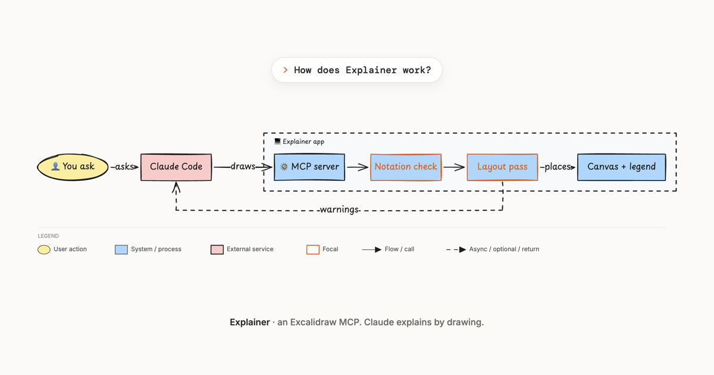

# Explainer: an Excalidraw MCP for Claude Code

Claude explains by drawing. Ask a question in Claude Code, and the answer lands as a diagram on an Excalidraw canvas, not as a wall of text.



- **One shape per meaning.** A fixed notation (user action, system step, decision, data, storage, outside service), sent to every MCP client in the `initialize` reply.
- **Notation check.** Every batch is checked; the agent gets exact warnings back and fixes them.
- **Layout pass.** Right-angle arrow routes, room for arrow labels, parked notes, overlap warnings. Tested on 17 diagram types.
- **Automatic legend** under every diagram.
- **Any MCP client:** Claude Code (CLI, Zed, VS Code), Cursor, Codex, Gemini CLI, stdio clients through `mcp-remote`.
- **Local first.** A Mac app (Electron). Drawings stay on your Mac; only a drawing you share goes to the cloud.

## Download

Get the Mac (`.dmg`, Apple silicon `arm64` or Intel `x64`) or Windows (`.exe`) app from [Releases](https://github.com/lucky-inkeeper/explainer/releases). The apps are unsigned:

- **macOS:** right-click the app > Open the first time. If macOS says the app is damaged, run `xattr -cr /Applications/Explainer.app`.
- **Windows:** in the SmartScreen dialog, click More info > Run anyway.

A release is built by GitHub Actions when you push a tag: `git tag v0.2.0 && git push origin v0.2.0` (set `version` in package.json to match first).

## Quick start

1. Download the app (above), or build it (below).
2. Connect Claude Code:
   ```
   claude mcp add --transport http explainer http://127.0.0.1:7331/mcp --scope user
   ```
3. Ask: "How does login work in this repo? Draw it."

## Develop

- `pnpm install` (once: `cd node_modules/electron && node install.js` if the Electron binary is missing)
- `pnpm dev` - run.
- `pnpm build` - builds the unsigned `dist/mac-arm64/Explainer.app` and copies it to `/Applications/Explainer.app`. Quit Explainer first. Open it from /Applications (right-click > Open the first time).
- `pnpm deploy:web` - deploy the shared-drawing viewer to https://explainer-pearl.vercel.app. The `.app` has its own copy of the UI and opens offline; `pnpm build` updates it (ADR-0010).
- `pnpm sync:setup` - once per Mac: saves the Vercel Blob token so menu > Share with link works (ADR-0008). Only drawings you share go to the cloud, as public blobs.
- Your data lives in `data/` (gitignored): `drawings/`, `app/`.

See `CONTEXT.md` and `docs/adr/` for how it fits together and why.

## License

MIT. The diagram rules in `agent/diagram-design/` are ported from [cathrynlavery/diagram-design](https://github.com/cathrynlavery/diagram-design) (MIT); see its `UPSTREAM.md` and `LICENSE`.
